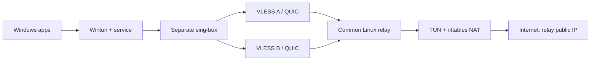

# Conflux

[Polski](README.pl.md) · [Architecture](docs/ARCHITECTURE.md) · [Security](docs/SECURITY.md) · [Acceptance](docs/ACCEPTANCE.md)

Conflux is a Windows 11 x64 IPv4 VPN client with an Ubuntu 24.04 relay. Bring your own UDP-capable VLESS paths: multiple ordinary QUIC connections carry one logical tunnel to one relay, whose public IP is the final Internet egress. The native Wails desktop supports English/Polish and light/dark/system appearance; a privileged background service owns networking.

**Pre-release source. No published binary release or signed installer is declared. The complete MVP has not passed real Windows/Ubuntu deployment, leak, crash/reboot, two-proxy aggregation and soak acceptance.** Use a disposable test machine with console access. Read [limitations](docs/LIMITATIONS.md) and the [acceptance matrix](docs/ACCEPTANCE.md) before routing sensitive traffic.



Bond mode needs at least two **actually tested** eligible paths. A parsed link or working TCP proxy is insufficient; SOCKS UDP and the relay QUIC handshake must work. Scheduling and bounded reorder operate above independent QUIC connections. Failed paths are excluded and recovered paths rejoin with health probation. Real target-environment evidence is required before relying on failover.

Two proxies over one physical ISP connection cannot multiply that connection's line rate. Benefits can include avoiding server caps/congestion and resilience, provided capacity exists. IPv6 tunneling is outside this IPv4 MVP; reversible IPv6 leak prevention must pass Windows acceptance. No analytics, advertising, remote crash upload or telemetry upload is included; diagnostics remain local unless manually shared.

## Get source and build

Install verified official Go **1.27.2**, Node.js **24**/npm and Git. Do not use an unrelated program named `go`; `go env GOVERSION` must return `go1.27.2`. From a clean checkout:

```sh
git clone https://github.com/filiprek/conflux-vpn.git
cd conflux-vpn
go mod download
make test
make frontend
make build
```

Core output: `dist/linux/conflux-relay`, `dist/linux/conflux-bench`, and `dist/windows/{conflux-service,confluxctl,conflux-bench}.exe`. Linux cross-build does not produce a Windows GUI. `make check` adds format/vet/race/shell checks. `make security` runs pinned govulncheck and npm audit. Full [test instructions](docs/TESTING.md) distinguish nested GUI-module tests and privileged checks. No fabricated release download link or bundled unverified runtime is provided.

For Windows, install official stable Wails v2 prerequisites including WebView2, Go 1.27.2 and Node 24, then run in PowerShell:

```powershell
./scripts/build-windows.ps1
# With NSIS 3.11 installed separately:
makensis deploy/windows/conflux.nsi
```

The GUI is `dist/windows/Conflux.exe`; the unsigned installer wrapper is `dist/Conflux-unsigned-setup.exe`. Read [Windows installation](docs/WINDOWS_NETWORKING.md) for supplied runtime verification and full command-line options. Do not treat a cross-build or an unexecuted CI workflow as a successful Windows install.

## Install the relay

Transfer the built Linux relay and `deploy/relay` directory to an Ubuntu 24.04 x86_64 VPS with root, TUN, public IPv4 and UDP 4433 access. On that host:

```sh
sudo bash deploy/relay/install-relay.sh \
  --binary /absolute/path/to/conflux-relay \
  --public-host relay.example.org
```

Substitute your real public hostname or IPv4. The script generates TLS identity and a random token, uses 0600 secrets, creates only owned networking state, and starts restricted systemd units. It prints a secret `conflux://...` enrollment **once** after local authenticated health checks. Save it privately and independently verify its fingerprint. Permit inbound UDP 4433 in your cloud/host firewall; existing forwarding policy may require explicit allowance. Never flush unrelated rules. [Deployment details, rotation and recovery](docs/RELAY_DEPLOYMENT.md).

## Install and use Windows

Download sing-box **1.14.3** from its official upstream and independently authenticate the archive checksum; keep the GPL license/source information. Obtain official amd64 Wintun from https://www.wintun.net/, verify its distribution terms, trusted hash and valid WireGuard Authenticode signature. Neither runtime is silently downloaded or included here. Wintun prebuilt license/hash verification remains a release blocker in this environment. See [third-party notices](THIRD_PARTY_NOTICES.md).

Determine the desktop user's SID before elevating with `[Security.Principal.WindowsIdentity]::GetCurrent().User.Value`. Run PowerShell as administrator, using that SID, actual verified runtime paths and expected SHA-256 values:

```powershell
./deploy/windows/install.ps1 -OwnerSID 'S-1-5-21-...' `
  -SourceDirectory "$PWD/dist/windows" `
  -SingBox 'C:/verified/sing-box.exe' -SingBoxSHA256 '<64 hex characters>' `
  -Wintun 'C:/verified/wintun.dll' -WintunSHA256 '<64 hex characters>'
```

The GUI runs unprivileged as the configured owner; installation places privileged files under administrator/SYSTEM ACLs. The NSIS wrapper accepts equivalent `/OWNER_SID=`, `/SINGBOX=`, `/SINGBOX_SHA256=`, `/WINTUN=`, `/WINTUN_SHA256=` arguments. It is unsigned; a trusted production publisher identity is not claimed.

1. Open `%ProgramFiles%/Conflux/Conflux.exe` as the intended owner.
2. Import the relay's secret enrollment privately, checking the fingerprint through your trusted channel.
3. Add your own `vless://` links. Review the parsed name/server/transport and unsupported-field errors. Do not share links in logs or tickets.
4. Test two or more nodes independently for end-to-end UDP/QUIC eligibility; select eligible nodes for Bond mode.
5. Connect and wait for authoritative service status. Confirm both paths carry real counters, IPv4 egress is the relay, DNS follows the tunnel and IPv6 does not leak.
6. In a controlled transfer, fail one path, observe remaining-path traffic and recovery, then disconnect and verify original networking is restored.

These are acceptance steps to execute, not results claimed here. [Controlled lab requirements](docs/LAB_ACCEPTANCE.md) describe equal-cap, RTT-skew, failure and soak scenarios. No throughput results have been invented.

## Recover and uninstall

Use the owner/admin CLI `confluxctl --pipe Conflux-<owner SID> status`, `disconnect`, `recover` and `diagnostics`. Imports read secrets from stdin; prefer the GUI to avoid shell history. Preserve recovery state on errors. [Troubleshooting](docs/TROUBLESHOOTING.md).

Close the GUI and uninstall from elevated PowerShell:

```powershell
& "$env:ProgramFiles/Conflux/uninstall.ps1"
# Optional -PurgeData intentionally deletes protected local data.
```

Successful disconnect/recovery is required before service removal. Default uninstall keeps protected data. Use the registered NSIS uninstaller if you installed through its wrapper. No global network reset or unrelated route/driver deletion occurs.

On the relay:

```sh
sudo bash deploy/relay/uninstall-relay.sh
```

Only owned service/network state is removed. Forwarding is restored only when still equal to the value assigned by Conflux; credentials and install evidence remain until explicitly purged. Follow the [full uninstall policy](docs/RELAY_DEPLOYMENT.md).

Apache-2.0 project source; separately supplied runtimes retain their own licenses. [Contributing](CONTRIBUTING.md) · [Security reporting](SECURITY.md) · [Changelog](CHANGELOG.md).
