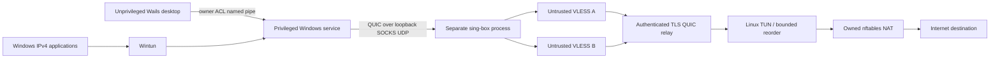

# Architecture

Conflux targets Windows 11 x64 clients and Ubuntu 24.04 x86_64 relays. It sends one logical IPv4 tunnel over multiple ordinary QUIC connections. It is not draft Multipath QUIC. The implementation status and target-platform evidence are recorded separately in [ACCEPTANCE.md](ACCEPTANCE.md).

The GUI is disposable and does not own routes or credentials. The service owns lifecycle serialization, DPAPI-protected secrets, the proxy process, packet devices, networking transactions and authoritative status. IPC is local, bounded and restricted to the configured owner's SID plus administrators/SYSTEM. A successful button click is insufficient to declare Connected.

`internal/protocol` defines bounded enrollment/control/datagram parsing. `internal/multipath` owns scheduling, path health and reorder limits. `internal/transport` owns direct UDP and SOCKS5 UDP sockets. `internal/proxy` validates VLESS and generates a controlled sing-box configuration. `internal/client` connects the transport to a packet device and provides session metrics. `internal/platform` confines Windows-specific privileges, DPAPI, Wintun and networking changes. `internal/relay` authenticates attachments, assigns client addresses and rejects spoofed source addresses.

Each underlay crosses an untrusted proxy. QUIC TLS terminates only at the client and relay; the proxy cannot decrypt tunnel contents. The relay is trusted to route the inner IP traffic and can inspect unencrypted application traffic. Website HTTPS remains the responsibility of applications. See [THREAT_MODEL.md](THREAT_MODEL.md).

Activation validates configuration, resolves endpoints, records recovery intent, establishes eligible paths and relay identity, prepares owned bypass routes, and activates Wintun, tunnel routes, DNS and reversible IPv6 protection. The service reports Connected only after activation. A failure rolls back completed operations; disconnect cancels and joins owned work, then restores only the service's recorded mutations. Startup first recovers a stale transaction. A failed recovery prevents a fresh activation.

Sending allocates a tunnel-wide sequence, selects an eligible healthy path and sends a bounded QUIC DATAGRAM. Receiving validates frame and IPv4 boundaries, reorders within packet/byte/time limits, and injects into the packet device. The relay checks assigned source ownership before TUN injection; return traffic is mapped to its destination session. Sequence gaps expire rather than blocking forever. Path loss must remove that path from scheduling; reconnection uses backoff/probation. Unit evidence does not prove operating-system recovery or throughput; those are release gates.
